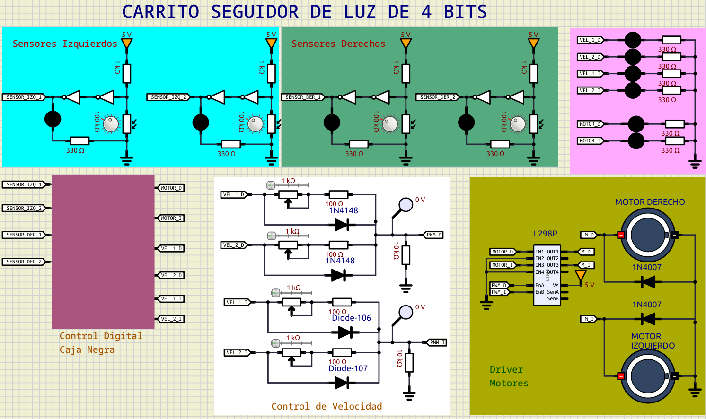
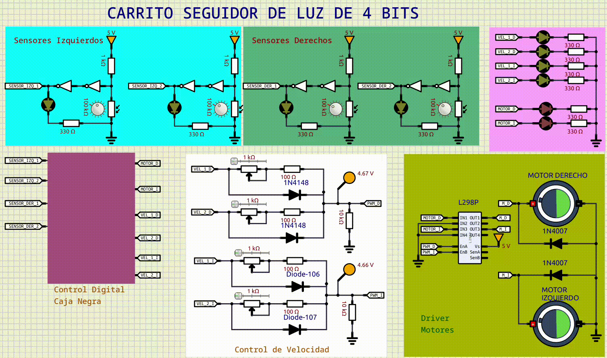
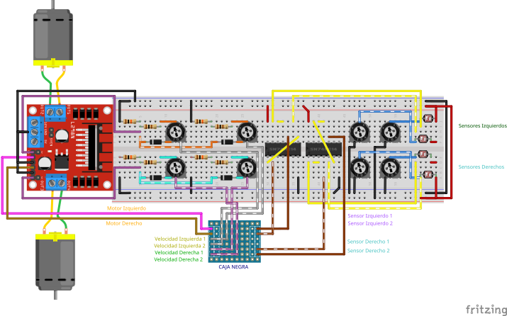

# Práctica 9. Carrito seguidor de luz de 4 bits [Equipo] (Proyecto)

## 1. Objetivo

Diseñar e implementar un sistema de control digital para un carrito seguidor de luz, utilizando cuatro sensores de luz como entradas de información. El sistema deberá procesar las señales de los sensores mediante lógica digital y controlar de manera independiente los motores derecho e izquierdo, permitiendo que cada motor trabaje a dos niveles de velocidad.

El propósito de la práctica es aplicar los conocimientos de sistemas digitales, compuertas lógicas, álgebra booleana y tablas de verdad en la solución de un problema real.

## 2. Descripción general del proyecto

Se deberá construir un carrito móvil capaz de detectar la presencia de una fuente de luz y responder mediante el movimiento de sus dos motores.

Para lograrlo, el carrito contará con cuatro sensores de luz distribuidos de la siguiente manera:

- Dos sensores en el lado izquierdo.
- Dos sensores en el lado derecho.

Las señales de estos sensores serán procesadas por un circuito de control digital, al que llamaremos **caja negra**. Esta caja negra deberá determinar qué motores activar y a qué velocidad deberán trabajar, de acuerdo con las condiciones detectadas.

## 3. Material

|   Cantidad   | Material                              | Descripción                                                           |
|:------------:|---------------------------------------|-----------------------------------------------------------------------|
|      1       | Multímetro                            | Para realizar mediciones eléctricas.                                  |
| Según diseño | Circuitos integrados 7404             | Compuertas NOT.                                                       |
| Según diseño | Circuitos integrados 7408             | Compuertas AND.                                                       |
| Según diseño | Circuitos integrados 7432             | Compuertas OR.                                                        |
| Según diseño | LED                                   | Indicadores visuales, si se requieren.                                |
| Según diseño | Resistencias de 330 Ω                 | Limitación de corriente y conexiones indicadas.                       |
|      4       | Resistencias de 1 kΩ                  | Para los circuitos de sensores y control.                             |
|      4       | Resistencias de 10 kΩ                 | Para los circuitos de sensores.                                       |
|      4       | Potenciómetros o presets de 1 kΩ      | Ajuste de los niveles de velocidad.                                   |
|      4       | Resistencias de 100 Ω                 | Para los circuitos de control de velocidad.                           |
|      4       | Diodos 1N4148                         | Para el circuito de control de velocidad.                             |
|      4       | Sensores de luz                       | Pueden ser sensores construidos por el equipo o módulos comerciales.  |
|      1       | DIP switch o push button              | Interruptor general de encendido y apagado.                           |
|      2       | Llantas                               | Para el desplazamiento del carrito.                                   |
|      2       | Motoreductores de corriente directa   | Motores con caja de engranes, con tensión de operación máxima de 5 V. |
|      1       | Rueda loca                            | Para proporcionar estabilidad al carrito.                             |
|      1       | Driver de motores L298P o equivalente | Etapa de potencia para controlar los motores.                         |
|      1       | Placa o soporte                       | Para montar los componentes y circuitos.                              |
| Según diseño | Fuente de alimentación y cables       | Para alimentar de 5V para todo el sistema (Sugerencia Powerbank)      |

**Importante:** Las cantidades de algunos componentes pueden variar dependiendo del diseño final. El equipo deberá verificar que cuenta con todos los elementos necesarios antes de comenzar el montaje.

## 4. Desarrollo

### 4.1. Identificación de entradas

El sistema deberá contar, como mínimo, con cuatro entradas:

| Entrada | Nombre             | Descripción                                                            |
|---------|--------------------|------------------------------------------------------------------------|
| A       | Sensor izquierdo 1 | Detecta la presencia de luz en la primera posición del lado izquierdo. |
| B       | Sensor izquierdo 2 | Detecta la presencia de luz en la segunda posición del lado izquierdo. |
| C       | Sensor derecho 1   | Detecta la presencia de luz en la primera posición del lado derecho.   |
| D       | Sensor derecho 2   | Detecta la presencia de luz en la segunda posición del lado derecho.   |

Para el diseño de la lógica digital, se deberá establecer una convención para las señales de los sensores. Se recomienda utilizar:

- 1 = El sensor detecta luz.
- 0 = El sensor no detecta luz.

Si el circuito electrónico del sensor entrega una señal con lógica inversa, deberá acondicionarse para que la caja negra trabaje con la convención anterior.

### 4.2. Identificación de salidas

La caja negra deberá proporcionar seis salidas de control:

| Salida | Nombre  | Descripción                                                        |
|--------|---------|--------------------------------------------------------------------|
| S1     | MOTOR_D | Señal de control para el motor derecho.                            |
| S2     | VEL_1_D | Selección del primer nivel de velocidad del motor derecho (50%).   |
| S3     | VEL_2_D | Selección del segundo nivel de velocidad del motor derecho.        |
| S4     | MOTOR_I | Señal de control para el motor izquierdo.                          |
| S5     | VEL_1_I | Selección del primer nivel de velocidad del motor izquierdo (50%). |
| S6     | VEL_2_I | Selección del segundo nivel de velocidad del motor izquierdo.      |

Las señales de velocidad deberán trabajar de la siguiente manera:

- **50% de velocidad:** se activa únicamente VEL_1 del motor correspondiente.
- **100% de velocidad:** se activan simultáneamente VEL_1 y VEL_2 del motor correspondiente.

El circuito de control de velocidad y el driver de motores se encargarán de llevar estas señales al motor correspondiente, de acuerdo con los diagramas proporcionados.

### 4.3. Filosofía de operación

El funcionamiento del carrito deberá cumplir las siguientes condiciones:

**A. Control del motor derecho**

El motor derecho será controlado por los sensores ubicados en el lado derecho:

1. Cuando ninguno de los dos sensores derechos detecte luz, el motor derecho deberá permanecer apagado.
2. Cuando únicamente uno de los dos sensores derechos detecte luz, el motor derecho deberá encenderse al 50% de su velocidad.
3. Cuando los dos sensores derechos detecten luz simultáneamente, el motor derecho deberá encenderse al 100% de su velocidad.

**B. Control del motor izquierdo**

El motor izquierdo será controlado por los sensores ubicados en el lado izquierdo:

1. Cuando ninguno de los dos sensores izquierdos detecte luz, el motor izquierdo deberá permanecer apagado.
2. Cuando únicamente uno de los dos sensores izquierdos detecte luz, el motor izquierdo deberá encenderse al 50% de su velocidad.
3. Cuando los dos sensores izquierdos detecten luz simultáneamente, el motor izquierdo deberá encenderse al 100% de su velocidad.

**C. Funcionamiento independiente de los motores**

Los motores deberán trabajar de manera independiente. Esto significa que cada uno responderá exclusivamente a las señales de sus dos sensores correspondientes.

Por lo tanto, pueden presentarse situaciones como las siguientes:

- El motor derecho está apagado y el izquierdo trabaja al 50%.
- El motor derecho trabaja al 100% y el izquierdo está apagado.
- Ambos motores trabajan al 50%.
- Un motor trabaja al 50% y el otro al 100%.
- Ambos motores trabajan al 100%.

### 4.4. Diseño del circuito digital

Antes de realizar el montaje físico, cada equipo deberá desarrollar el diseño lógico de la caja negra.

Para ello deberá:

1. Identificar y nombrar todas las entradas y salidas.
2. Elaborar la tabla de verdad completa del sistema, considerando las cuatro entradas.
3. Obtener una ecuación booleana para cada una de las seis salidas.
4. Simplificar las ecuaciones mediante álgebra booleana y/o mapas de Karnaugh. Puedes hacerlo a mano o usando alguna aplicación.
5. Diseñar el circuito lógico utilizando las compuertas necesarias.
6. Verificar que el circuito diseñado cumpla con todas las condiciones establecidas en la filosofía de operación.

### 4.5. Construcción y montaje

Una vez terminado y verificado el diseño lógico, se deberá realizar el montaje del proyecto.

El montaje deberá contemplar las siguientes etapas:

1. Construir los cuatro circuitos de sensores de luz.
2. Verificar que cada sensor entregue correctamente su señal lógica.
3. Construir la caja negra con las compuertas necesarias para implementar las ecuaciones obtenidas.
4. Construir el circuito de control de velocidad para ambos motores, considerando los componentes y conexiones mostrados en los diagramas.
5. Conectar las salidas de control al driver de motores.
6. Conectar los motores derecho e izquierdo.
7. Integrar el interruptor general.
8. Realizar las conexiones de alimentación y verificar que no existan cortocircuitos antes de energizar el sistema.

Los diagramas proporcionados sirven como referencia para comprender la distribución y conexión de los componentes. El diseño lógico de la caja negra deberá ser desarrollado por cada equipo.

### 4.6. Pruebas y funcionamiento

Una vez terminado el montaje, deberán realizarse pruebas para comprobar el funcionamiento del carrito.

Como mínimo, deberán probarse las siguientes situaciones:

- Ningún sensor detecta luz.
- Solamente el primer sensor izquierdo detecta luz.
- Solamente el segundo sensor izquierdo detecta luz.
- Los dos sensores izquierdos detectan luz.
- Solamente el primer sensor derecho detecta luz.
- Solamente el segundo sensor derecho detecta luz.
- Los dos sensores derechos detectan luz.
- Los sensores de ambos lados detectan luz en diferentes combinaciones.
- El interruptor general se encuentra apagado mientras los sensores detectan luz.

Se deberá comprobar que los motores respondan correctamente y que los dos niveles de velocidad puedan distinguirse.

## 5. Consideraciones adicionales

1. Si se presentan combinaciones de sensores que no estén contempladas explícitamente en la filosofía de operación, el equipo deberá definir y justificar el comportamiento esperado.
2. Se podrán agregar entradas o salidas adicionales si el equipo considera que mejoran el funcionamiento del proyecto. Por ejemplo: indicador de encendido, indicador de detección de luz, indicador de error o una entrada de paro.
3. Cualquier modificación deberá documentarse y justificarse.
4. Se deberá cuidar la alimentación eléctrica de los motores y de los circuitos integrados. No se deberán conectar los motores directamente a las salidas de las compuertas lógicas.
5. Los niveles de velocidad deberán ajustarse y comprobarse físicamente. El porcentaje indicado representa el nivel de velocidad esperado, por lo que será necesario calibrar el circuito para aproximarse a dichos valores.

Nota: Si se implementa alguna mejora bien implementada te puedes ganar desde 0.5 hasta 2 puntos extras, esto queda a consideración del docente, si lo implementas no necesariamente puede aplicar puntaje extra.

## 6. Entregables

Cada equipo deberá presentar un reporte y el prototipo fisico:

### Reporte PDF

1. Hoja de presentación
2. Índice automatico
3. Tabla de verdad completa.
4. Ecuaciones booleanas de las seis salidas.
5. Procedimiento de simplificación de las ecuaciones.
6. Diagramas de los circuitos lógicos.
7. Diagrama de conexiones del montaje completo.
8. Simulación (opcional)
9. **Prototipo funcional**

El equipo deberá ser capaz de explicar el funcionamiento del sistema, justificar sus decisiones de diseño y demostrar que el circuito construido cumple con la tabla de verdad.
## 7. Diagrama esquematico

### 7.1 Animación

[Descargar video de la animación](./practica_9/carrito_seguidor_luz_4bits.mp4)

### 7.2 Diagrama pictorico

Muestra de armado de referencia, analice bien con respecto al diagrama esquematico.

> *Puede contener errores*

<!-- Logisim -->
[.](./practica_9/carrito_seguidor_luz_4bits.circ)

<!-- Simulide -->
[.](./practica_9/carrito_seguidor_luz_4bits.circ)
